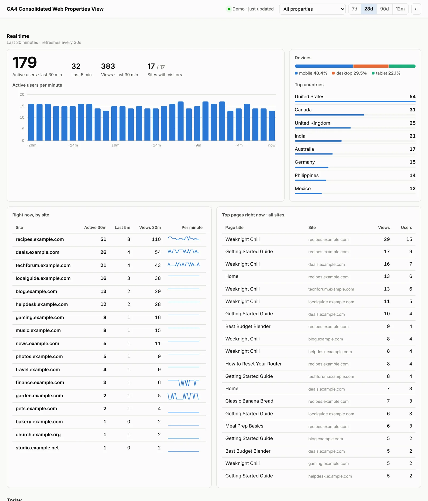

# GA4 Portfolio Dashboard

**Real-time and historical Google Analytics 4 for all your sites on one screen.**

Google Analytics shows one property at a time, and its combined "roll-up" properties need GA4 360. If you run several sites, there's no free way to see *"how many people are on all my sites right now?"* This dashboard is a small self-hosted PHP app that does that.



## Features

**All properties at once (landing page)**
- Active users across every property in the last 30 and last 5 minutes, refreshing every 30 seconds
- Per-minute bar chart, live device split and top countries
- "Right now, by site" table with a per-minute sparkline for each site
- Top pages being read across all sites right now
- Today vs. yesterday, by hour
- Last 7 / 28 / 90 days or 12 months, compared with the period before
- Sortable table of every site: users, change, share, sessions, views, engagement and daily trend

**One property (click any site)**
- The same real-time, today and period views for that site
- Top pages, landing pages, channels, sources, countries and devices
- A link straight to that property in Google Analytics

**Built to be easy to self-host**
- Plain PHP 8 with curl and OpenSSL: no Composer, no database, no build step, no third-party JavaScript
- Finds your GA4 properties automatically; new properties show up on their own
- API calls run in parallel and are cached, so any number of open tabs uses the quota of one
- Password login, optional IP allow-list, `noindex` headers and a strict Content-Security-Policy
- Light and dark mode, works on phones
- **Demo mode**: with no key configured it runs on sample data, so you can try it in 10 seconds

## Try it in 10 seconds (demo data)

```bash
git clone https://github.com/becomethesolution/ga4-portfolio-dashboard.git
cd ga4-portfolio-dashboard
php -S localhost:8080
```

Open <http://localhost:8080>. It runs on sample data until you add a Google key.

## Requirements

- PHP 8.0 or newer with the `curl` and `openssl` extensions (standard in almost every PHP install)
- Apache 2.4 (the bundled `.htaccess` files protect private folders) or Nginx (see below)
- A Google account with access to the GA4 properties you want to see

## Setup

### 1. Create a Google service account (one time)

1. In the [Google Cloud console](https://console.cloud.google.com/), create a project (any name).
2. Under **APIs & Services → Library**, enable:
   - **Google Analytics Data API**
   - **Google Analytics Admin API**
3. Under **IAM & Admin → Service Accounts**, create a service account. You can skip the optional role steps.
4. Open the service account, then **Keys → Add key → Create new key → JSON**. A file downloads. **This file is a password.** Never commit it or put it in your web root.
5. Copy the service account's email address (`name@project-id.iam.gserviceaccount.com`).
6. In Google Analytics, go to **Admin → Account access management → + Add users**. Paste that email, choose the **Viewer** role, and untick "Notify". Granting it at the **account** level covers every property in that account at once. If your properties are in several accounts, repeat this for each one.

### 2. Install

```bash
# 1. Put the key somewhere the web server can read but the web can't
mkdir -p ~/ga-dashboard-private
mv ~/Downloads/your-key.json ~/ga-dashboard-private/service-account.json
chmod 600 ~/ga-dashboard-private/service-account.json

# 2. Put the app in your web root
git clone https://github.com/becomethesolution/ga4-portfolio-dashboard.git /var/www/stats
cd /var/www/stats
cp config.sample.php config.php

# 3. Make a password hash and paste it into config.php
php -r "echo password_hash('choose-a-long-password', PASSWORD_DEFAULT), PHP_EOL;"
```

In `config.php`, set `service_account_key` to the full path of the key file, paste the hash into `password_hash`, and optionally set `account_id`. The `cache/` folder must be writable by the web server.

Open the site. If the footer still says **Demo data**, the key path is wrong or the web server can't read the file. If a yellow banner says *"User does not have sufficient permissions"*, step 1.6 hasn't taken effect yet; it can take a few minutes.

### Updating

```bash
cd /var/www/stats && git pull
```

`config.php` and the cache are git-ignored, so updates never overwrite your settings.

### Nginx

The `.htaccess` files only work on Apache. On Nginx, add rules that block everything except the app's entry points:

```nginx
location ~ /\.            { deny all; }
location ~ ^/(lib|cache|tests|docs)/ { deny all; }
location ~ ^/config(\.sample)?\.php$  { deny all; }
location ~ \.(md|json|ya?ml|sh)$      { deny all; }
add_header X-Robots-Tag "noindex, nofollow" always;
```

## Where to run it

| | How | Good for |
|---|---|---|
| **Local only** | A local host name, open it on the server | Most private |
| **Home or office network** | Open it by LAN IP; set `allowed_ips` | Phone or laptop on the same network |
| **From anywhere** | A subdomain over HTTPS, password **on**, plus something like Cloudflare Access in front | Checking from your phone anywhere |

If the dashboard sits behind Cloudflare's proxy **and** your server only accepts Cloudflare traffic, set `trust_cloudflare_ip_header` to `true` so `allowed_ips` sees real visitor IPs. Leave it `false` otherwise.

## Reading the numbers

- **Users are added up site by site.** Someone who visits two of your sites counts twice in the all-sites total. Views and sessions add up exactly.
- **Real time covers the last 30 minutes.** That's the maximum the Data API allows for standard GA4 properties. Real-time page names are page *titles*, because GA4 doesn't expose page paths in real time.
- **Period reports end yesterday** (full days) and compare with the same number of days before, like the GA interface. Today is shown separately, compared with yesterday by hour.
- **Small differences from the GA website are normal.** GA applies thresholding and rounding differently in its own interface.
- **GA only counts browsers that load your tag.** Bots, ad-blocked visitors and server-cached hits never appear, so this is not a measure of server load.

## API quota

Each refresh asks Google for five small real-time reports per property, fired in parallel and cached for 25 seconds. History is cached for 5–30 minutes. For a typical portfolio of 5–25 properties, that's well inside the free [Data API quotas](https://developers.google.com/analytics/devguides/reporting/data/v1/quotas). If you hit a quota error, raise `realtime_refresh_seconds` to 60.

## How it works

```
index.php            page shell + login
api.php              JSON endpoints: properties, realtime, summary, property
lib/GA.php           service-account JWT auth, property discovery, parallel curl, file cache
lib/Reports.php      builds cross-property roll-ups from the Data API responses
lib/Demo.php         sample data in the exact shape Google returns (demo mode + tests)
assets/app.js|css    the interface: hand-rolled SVG charts, no libraries
config.sample.php    copy to config.php
cache/               cached API answers (safe to delete any time)
tests/smoke.sh       starts PHP's built-in server in demo mode and checks every endpoint
```

## Contributing

Issues and pull requests are welcome. See [CONTRIBUTING.md](CONTRIBUTING.md). To report a security problem, see [SECURITY.md](SECURITY.md).

## License

[MIT](LICENSE). This project is not affiliated with or endorsed by Google. Google Analytics is a trademark of Google LLC.
